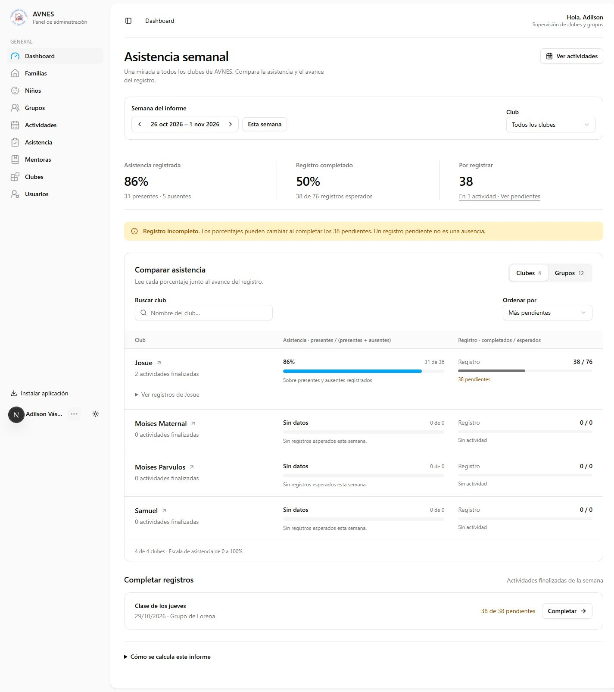
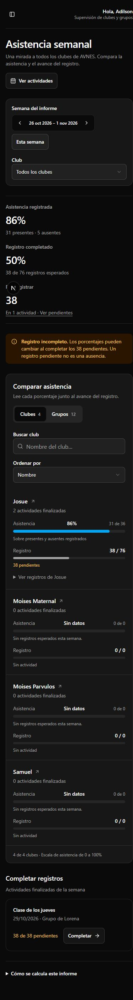

# Rediseño del dashboard de AVNES — 2 de noviembre de 2026

## Alcance confirmado

Administradores y coordinadores comparten el mismo dashboard y ven todos los clubes. Prioridad: analizar asistencia y comparar clubes/grupos; después completar registros. Semana actual por defecto, con consulta de semanas anteriores. Paleta existente conservada. Vista de mentores y reglas de cálculo sin cambios.

## Resultado

- Resumen semanal en una franja compacta, diferenciando asistencia, cobertura del registro y pendientes.
- Comparación en un espacio único: selector Clubes/Grupos, búsqueda por nombre y orden por nombre, asistencia o pendientes.
- Asistencia representada en una escala común de 0 a 100%, acompañada del denominador real y la cobertura del registro.
- Desglose desplegable con presentes, ausentes, permisos y pendientes. Enlaces desde cada club a su informe semanal.
- Estados sin datos que no confunden ausencia de información con 0% de asistencia, y aviso explícito cuando faltan registros.
- Actividades pendientes con acceso directo a completar asistencia; metodología disponible bajo demanda.
- Controles etiquetados, foco visible, valores textuales equivalentes a las barras y registros apilados en móvil.
- Skeleton específico para el informe administrativo.

## Comprobaciones

- `npm run build`: correcto.
- `npx tsc --noEmit`: correcto.
- Biome sobre los cinco archivos de la implementación: sin errores ni advertencias.
- Detector Impeccable: sin hallazgos en los archivos cambiados.
- Suite general: 5 aprobadas, 3 integraciones omitidas al ejecutarse sin variables de base de datos.
- Pruebas específicas del dashboard con `.env`: 2 aprobadas, incluyendo la consulta SQL con fixtures de solo lectura; ninguna omitida. Verifican semana de El Salvador, permisos, pendientes y deduplicación de actividades compartidas.
- Navegador: semana actual vacía, semana anterior con datos, cambio Clubes/Grupos, búsqueda, recuperación de búsqueda vacía, orden por pendientes, desglose y filtro por club.
- Visual: 1440 px de escritorio, 390 px móvil, variantes oscura/clara; comprobación de ancho a 320 px sin desbordamiento horizontal.
- Revisión independiente Impeccable: `ship`, sin correcciones materiales en el alcance de las capturas y componentes suministrados.

## Límites de la revisión

La revisión visual independiente cubrió las capturas oscuras de escritorio y móvil; la variante clara y las interacciones fueron verificadas por el agente principal. No hubo mockup raster aprobado ni comparación independiente con un tablero de referencias visuales. No se probaron dispositivo físico, lector de pantalla, desconexión de red ni una sesión separada de coordinador. La rama de autorización compartida se conservó y revisó en código. No se alteraron datos para realizar estas comprobaciones.

## Evidencia

Capturas de la semana histórica del 26 de octubre al 1 de noviembre de 2026, que contiene registros reales de prueba. La aplicación sigue abriendo en la semana actual.

## Vista mensual

Se agregó un selector Semanas/Meses. La vista mensual calcula sobre el rango completo del mes calendario; no promedia porcentajes semanales. Se conservan club y período en enlaces de desglose. Los meses futuros se limitan al actual. Validación: cinco pruebas (fechas, enlaces e integración SQL), TypeScript, compilación de producción y detector Impeccable sin hallazgos. Comprobación visual a 1440 y 390 px.
