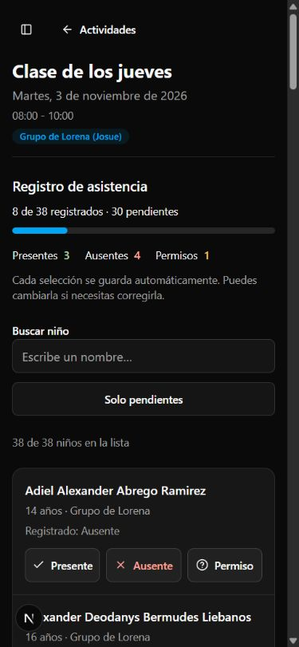

# Revisión de interfaz AVNES Admin — 2 de noviembre de 2026

Aplicación de Impeccable en modo Operate, conservando el azul y la paleta semántica existentes. Prioridad: administradores en computadora y mentores tomando asistencia desde el teléfono.

## Correcciones aplicadas

- Asistencia: controles de 44 px, texto visible en móvil, selección accesible mediante aria-pressed y estado de guardado por niño. La interfaz solo confirma éxito cuando la acción devuelve datos; conserva la selección anterior ante errores y permite reintentar.
- Resumen compacto con registrados, pendientes y progreso accesible. Búsqueda por nombre sin distinguir tildes y vista de pendientes. Los totales conservan el alcance del club/grupo, independientemente de la búsqueda.
- Un niño que pertenece a varios grupos se muestra y cuenta una vez dentro del alcance seleccionado; los cambios se propagan a todas sus asignaciones. El estado local se reinicia al cambiar de actividad.
- Filtros disponibles cuando hay varios grupos aunque exista un solo club. Etiquetas asociadas a los controles en asistencia y niños.
- Agenda: muestra días con actividades y el día actual, evitando recorrer días vacíos. Mensaje orientativo para meses sin actividades. Selector de vista con texto visible en móvil y foco de teclado.
- Calendario: error recuperable y protección frente a respuestas fuera de orden al cambiar mes o filtros rápidamente.
- Títulos móviles para las secciones administrativas, regreso visible desde una actividad y enlace para saltar al contenido.
- Controles compartidos con mayor superficie táctil; diálogos limitados por el alto disponible con desplazamiento interno y cierre etiquetado en español.
- Login: autocompletado apropiado, tipo email, acción en español y etiqueta dinámica para mostrar/ocultar contraseña.
- Se conserva el azul de marca. El texto sobre el fondo azul utiliza el neutral oscuro existente para mejorar contraste. Las métricas dejan de usar entradas escalonadas y efectos de hover decorativos. Los overlays respetan movimiento reducido.

## Validación realizada

- `npm run build`: compilación de producción completada.
- `npx tsc --noEmit`: sin errores, incluyendo el estado final.
- Biome sobre los 28 archivos de código modificados: sin errores; queda la advertencia previa por document.cookie en la persistencia del menú lateral.
- `npx tsx --test tests/*.test.ts`: 5 pruebas aprobadas, 3 de integración de base de datos omitidas por la configuración del proyecto.
- Detector Impeccable sobre src/app y src/components: sin hallazgos devueltos. No equivale a una certificación completa de accesibilidad.
- Navegador: login de prueba, agenda, asistencia, búsqueda, búsqueda sin resultados y formulario de creación de niño; escritorio 1366×900 y móvil 390×844. Comprobación de desbordamiento a 320 px. Inspección de variantes clara y oscura.
- Guardado real: se cambió temporalmente un registro existente y se restauró su estado anterior; la recarga confirmó persistencia. La operación actualizó su fecha de modificación.

## Límites

No se ejecutaron pruebas con un dispositivo físico, un lector de pantalla ni una cuenta independiente de mentor. El manejo de errores de red se revisó en código, sin una desconexión simulada. No se crearon niños, familias o cuentas para probar todos los formularios. La revisión se concentra en asistencia y en los componentes compartidos, con muestreo visual del resto; no se afirma cobertura exhaustiva de todas las combinaciones de datos y permisos.

Los cambios de instalación de Impeccable en skills-lock.json y las carpetas de skills ya estaban presentes y no forman parte de esta implementación.

